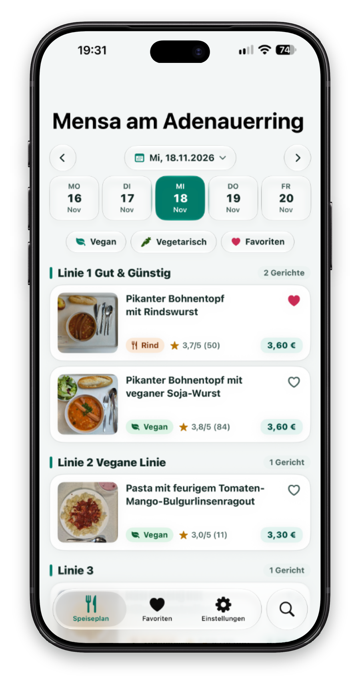
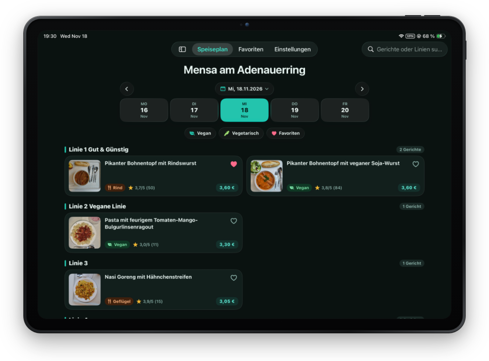

# Mensa KA for iOS

A native Swift and SwiftUI app for iOS and iPadOS to browse Karlsruhe university canteen menus, built as a dependency-free Swift Package Manager project with **iOS Liquid Glass**.

> **API Credit:** This app is powered by the GraphQL backend from **[kronos-et-al/MensaApp](https://github.com/kronos-et-al/MensaApp)** (`https://api.mensa-ka.de/`). Huge thanks to the MensaApp maintainers for building and operating such a clean, rich, and reliable API!

<p align="center">
  
  &nbsp;&nbsp;
  
</p>

---

## Features

- **Native SwiftUI & Liquid Glass UI**: Built for iOS 26+ with Apple's Liquid Glass design system: native large-title navigation, adaptive `TabView` (`.sidebarAdaptable` on iPadOS, dedicated `Tab(role: .search)` on iPhone, `.tabBarMinimizeBehavior(.onScrollDown)`), interactive `GlassEffectContainer`, `.glassEffect(...)`, `.buttonStyle(.glass)`, and `glassEffectID` morphing controls (with automatic Reduce Transparency fallbacks), `.scrollEdgeEffectStyle(.soft, for: .all)`, `ConcentricRectangle` cards, zoom navigation transitions, SF Symbols, and tactile haptics.
- **Adaptive iPad & Multitasking Layout**: Scales cleanly between single-column layouts on iPhone / Slide Over and centered two-column `LazyVGrid` grids on iPad and wide Split View windows (`portrait` and `landscape`), with centered section headers and adaptive photo galleries.
- **Daily Menus & Quick Date Navigation**:
  - Browse meals grouped by serving line (automatically cleaning redundant time-window suffixes).
  - Swipe left or right across the menu or tap the 5-day week strip (`WeekStripView`) to switch weekdays, plus a quick shortcut to jump back to today.
  - Tap the date selector row below the title bar to open the graphical SwiftUI calendar modal (`DatePicker`) with Liquid Glass buttons to pick any date, advance by a week, or return to today (with optional weekend skipping).
- **Dietary Filters, Canteen & Price Tiers**:
  - Filter daily menus by **Vegan**, **Vegetarian**, and **Favorites**.
  - Choose your active Karlsruhe canteen and switch prices between **Student**, **Employee**, **Pupil**, and **Guest** in **Settings**.
- **Scoped Meal Search**: Search dishes and serving lines within the currently selected canteen via the dedicated **Search** tab on iPhone or the top-right toolbar `.searchable` pill on iPad.
- **Favorites with Offline Snapshots**: Save favorite dishes locally; meals not served on the selected date remain visible under *Saved for Other Days* with their last seen date.
- **Community-Filtered Meal Photos & Fullscreen Viewer**:
  - Meal photos fetch community `upvotes` and `downvotes` from the API and automatically hide images that have more dislikes than likes (`downvotes > upvotes`), keeping positively rated or neutral photos sorted by rank.
  - Single photos center cleanly in the meal detail gallery while multi-photo carousels paginate cleanly without overlapping.
  - Tap any photo in the feed or detail gallery to open the fullscreen swipeable photo viewer (`LightboxView`) with horizontal paging across all photos, pinch and double-tap zoom, tap-to-toggle chrome, the dish name and serving line caption, and native Liquid Glass share (`ShareLink`) and close controls.
- **Customizable Meal Detail Page**:
  - Detailed cards for **Prices**, **Nutrition Facts**, **Included / Available Sides**, **Allergens & Additives**, **Environmental Impact** (CO2 emissions & water usage), and **Meal Statistics** (*Last Served*, *Next Served*, *Times Served in the Last 3 Months*, and *New* badge).
  - Reorder and toggle individual detail sections via **Settings -> Meal Detail Page -> Sections & Order** using native drag-and-drop editing.
- **English & German Localization**: Follows the iOS system language by default (`System`) and can be switched between **Deutsch** and **English** in **Settings -> Appearance**.
- **Themes, Custom API Endpoint & Offline Cache**: Supports `System`, `Light`, and `Dark` themes, runtime GraphQL endpoint overrides in Settings (with one-tap reset to `api.mensa-ka.de`), persistent disk offline caching (`Caches/MensaKA/`), disk + memory image caching, Keychain client ID storage, and one-tap cache clearing.

---

## Installation

Mensa KA requires **iOS or iPadOS 26.0+** and is distributed as an unsigned `.ipa` without paid Apple Developer entitlements (`ITSAppUsesNonExemptEncryption: false`).

1. Obtain `MensaKA-unsigned.ipa` from the repository's **Releases** or from an **Actions -> Build Unsigned iOS IPA** workflow run artifact (`MensaKA-unsigned-release-ipa`).
2. Install `MensaKA-unsigned.ipa` on your iPhone or iPad using one of the following methods:
   - **Free Apple ID**: Sideload with **AltStore**, **SideStore**, or **LiveContainer** (no paid Apple Developer account required).
   - **Paid / Bought Apple ID Certificates**: Sign and install with your own paid Apple Developer certificate or a signing app/service (e.g., **Feather**, **ESign**, **GBox**, or **Sideloadly**).
   - **TrollStore**: Permanently install directly on supported iOS/iPadOS versions via **TrollStore** with no 7-day re-signing limit.
   - **AppSync Unified**: Install directly on jailbroken devices equipped with **AppSync Unified** (e.g., via **Filza** or **Sideloadly**).

---

## Tech Stack

- **Language & UI**: Pure **Swift 6** & **SwiftUI** (zero third-party SwiftPM dependencies)
- **Package & Build Manifest**: Swift Package Manager (`Package.swift`)
- **System Frameworks**: `SwiftUI`, `Observation`, `Foundation` (`URLSession`), `Security` (Keychain), `CryptoKit` (`SHA256` disk cache keys), `UIKit` (adaptive colors & haptics)

---

## Project Structure

```text
mensa-ka-ios/
├── Package.swift                       # SwiftPM manifest targeting iOS 26+
├── Info.plist                          # App metadata, orientations & status bar configuration
├── Resources/
│   └── AppIcon.png                     # 1024x1024 app icon
├── Sources/MensaKA/
│   ├── MensaKAApp.swift                # @main SwiftUI App, adaptive TabView, calendar & lightbox
│   ├── Models/
│   │   └── MensaModels.swift           # Codable + Sendable domain models and preferences
│   ├── Localization/
│   │   └── Strings.swift               # EN/DE dictionaries, allergen and additive labels
│   ├── Theme/
│   │   └── Theme.swift                 # Adaptive color palette & iOS 26+ Liquid Glass modifiers
│   ├── Utils/
│   │   ├── DateUtils.swift             # Weekday, ISO date & calendar formatting helpers
│   │   └── Utils.swift                 # Euro/rating formatting, image vote & meal filtering, haptics
│   ├── Services/
│   │   ├── GraphQLClient.swift         # URLSession GraphQL client & queries
│   │   ├── PersistenceService.swift    # UserDefaults, Keychain & JSON disk meal plan cache
│   │   └── ImageCache.swift            # Actor-backed NSCache + CryptoKit SHA256 disk image cache
│   ├── Store/
│   │   └── MensaStore.swift            # @Observable @MainActor state container
│   └── Views/
│       ├── Components/                 # CachedMealImage, MealTypeBadge, MealCardView, WeekStripView, ...
│       └── Screens/                    # MenuView, FavoritesView, SearchView, SettingsView, LightboxView, ...
├── scripts/
│   ├── frame-screenshot.mjs            # Composites screenshots into iPhone 18 Pro Max & iPad Pro bezels
│   └── iphone-18-pro-max-frame.png     # Transparent iPhone 18 Pro Max bezel overlay template
└── .github/workflows/
    └── build-ios-ipa.yml               # CI workflow: unsigned .ipa build & v* tag releases
```

---

## Automated Builds & Releases (CI)

The repository includes [`.github/workflows/build-ios-ipa.yml`](.github/workflows/build-ios-ipa.yml) (`Build Unsigned iOS IPA`), running on GitHub Actions (`xcode-27` on Apple Silicon):

1. Triggers automatically on version tags (`v*`), or manually via **Actions -> Build Unsigned iOS IPA -> Run workflow**.
2. Builds the unsigned `.app` bundle for the chosen configuration (`release` or `debug`), packages it into `MensaKA-unsigned.ipa`, and uploads `MensaKA-unsigned-<configuration>-ipa`.
3. **GitHub Releases (`v*` tags)**: When a version tag like `v2.0.0` is pushed, the workflow automatically creates or updates a GitHub Release with `MensaKA-unsigned.ipa` attached.

To frame raw iPhone and iPad screenshots manually:

```bash
node scripts/frame-screenshot.mjs path/to/raw-iphone.png assets/screenshot-iphone.png
node scripts/frame-screenshot.mjs path/to/raw-ipad.png assets/screenshot-ipad.png --device ipad
```

---

## Credits & Acknowledgments

- **Mensa KA API**: All canteen schedules, meal details, images, nutritional values, allergens, environmental metrics, and meal statistics are served by the GraphQL API from **[https://github.com/kronos-et-al/MensaApp](https://github.com/kronos-et-al/MensaApp)**. Thank you for creating and maintaining this awesome API!

---

## License

Licensed under the [MIT License](LICENSE).
